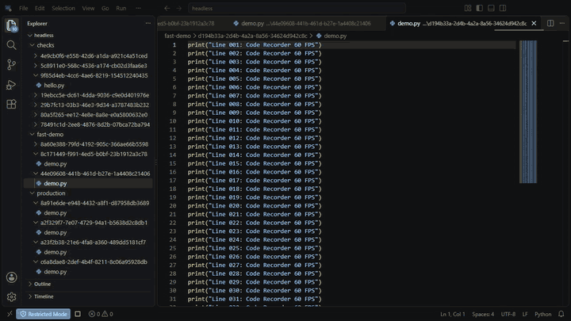

# code-recorder

**Your code. In motion.** Record coding sessions and create automatic typing demos in a familiar Code - OSS based editor.



[Watch the typing demo with sound](media/intro.mp4)

Keep your file explorer, minimap, autocomplete, themes and extensions while turning your work into MP4 videos. Use the desktop app yourself, or let an AI create recordings through MCP in headless mode.

## Features

- **One-button recording:** Click the red recording button to start, then click again to stop and save.
- **TypeIt:** Retype a file or selection one character at a time in a new document, leaving the original unchanged.
- **Typing sound:** Turn keyboard clicks on or off and adjust their volume.
- **Workspace restore:** Open a folder or recent project, then resume your work on the next launch.
- **Headless recording:** Create videos without displaying the editor window.
- **MCP controls:** Create files, type code, move the cursor, preview the editor and record videos.
- **Zoom controls:** Enlarge or shrink the entire UI or just the code text, then reset either one.
- **Camera framing:** Zoom into a captured region and pan smoothly without changing editor settings.
- **Recording options:** Choose output resolution and FPS, with project navigation and smooth scrolling through MCP.
- **Extensions:** Install extensions from Open VSX or VSIX files.

## Get started

This early Windows version uses a separately prepared VSCodium runtime. A ready-to-install editor package is not included yet.

You will need Node.js 24, npm, FFmpeg, a VSCodium runtime and a Code - OSS checkout. Install the dependencies and create your configuration:

```powershell
npm install
Copy-Item runtime.example.json runtime.json
```

Set the paths in `runtime.json`: `runtime` for the VSCodium folder, `source` for the Code - OSS checkout, `data` and `extensions` for the app's profile folders, and `node` and `ffmpeg` for their executables.

Launch the desktop app:

```powershell
.\launch.cmd
```

Or launch without displaying a window:

```powershell
.\launch.cmd -Headless
```

If you have the executable launcher, use `code-recorder.exe` or `code-recorder.exe --headless`. Headless mode currently runs within a logged-in Windows desktop session.

## Record a coding session

1. Open a folder or recent project.
2. Click the **red recording circle** at the bottom left.
3. Edit or present your code.
4. Click the **stop button** in the same position.
5. Find the MP4 in `outputs/`.

The video captures the editor itself, so other windows covering it are not included. Default output is 1920 × 1080 at 30 fps, with synchronized typing audio when enabled.

## Make a typing demo

Open a code file, optionally select some text, then run **Record: TypeIt (Retype Code and Record)** from the command palette.

Use **Record: Toggle Typing Sound** to turn keyboard clicks on or off. Adjust playback in Settings:

| Setting | Default | Description |
| --- | --- | --- |
| `movie.typingSound.enabled` | `false` | Enable typing sound |
| `movie.typingSound.volume` | `0.35` | Volume from 0 to 1 |
| `movie.typingDelayMs` | `70` | Delay per character in milliseconds |

Press **F6** for the bundled demo, or run an [example scene](examples/quick-start.json):

```powershell
node cli.mjs --headless examples/quick-start.json
```

## Quick guide for AI agents

Connect the MCP server using `mcp-config.example.json`, replacing the example path with the absolute path to `mcp.mjs`. MCP recording defaults to an isolated headless session.

| Tool | What it does |
| --- | --- |
| `record_app` | Start, inspect or close the session |
| `record_file` | Create, open, read, list or save files |
| `record_type` | Type text into the active document |
| `record_cursor` | Move the cursor, select lines or scroll |
| `record_frame` | Return an image of the editor |
| `record_zoom` | Zoom the whole UI or code text in, out or back to its default |
| `record_camera` | Zoom and pan the captured image, with optional smooth transitions |
| `record_config` | Set or inspect recording FPS and output size |
| `record_project` | List/open projects, show the project picker or reveal Explorer |
| `record_scroll` | Scroll by lines/pages, to a line, or to the top/bottom |
| `record_recording` | Start, stop or check a recording |

Call these MCP tools in order:

```json
[
  { "tool": "record_app", "arguments": { "action": "start", "headless": true } },
  { "tool": "record_file", "arguments": { "action": "create", "path": "demo/hello.py", "text": "" } },
  { "tool": "record_config", "arguments": { "action": "set", "fps": 30, "width": 1280, "height": 720 } },
  { "tool": "record_recording", "arguments": { "action": "start", "name": "hello-record", "typingSound": true } },
  { "tool": "record_type", "arguments": { "text": "print(\"Hello, Record!\")\n", "delayMs": 80 } },
  { "tool": "record_camera", "arguments": { "action": "set", "scale": 2, "x": 0.55, "y": 0.3, "durationMs": 600 } },
  { "tool": "record_frame", "arguments": {} },
  { "tool": "record_camera", "arguments": { "action": "reset", "durationMs": 600 } },
  { "tool": "record_recording", "arguments": { "action": "stop" } },
  { "tool": "record_recording", "arguments": { "action": "status" } }
]
```

Repeat the status call until `completed`, then return the MP4 path in `output`. If the recording fails, use the returned `error` to identify the issue.

For zoom, choose `target: "ui"` for the entire editor window or `target: "editor"` for code text only. Use `action: "in"`, `"out"` or `"reset"`, with optional `steps` from 1 to 10. Reset returns UI zoom to its configured default or code text to its base font size. Zoom works during recording without changing the output resolution.

For camera framing, use `record_camera` with `scale` from 1 to 8 and center coordinates `x`/`y` from 0 to 1. `durationMs` animates zoom or pan; `action: "state"` reports progress and `"reset"` returns to the full image. `record_frame` shows the same framing as the video; use `raw: true` for an untransformed preview.

Set FPS from 1 to 60 with `record_config` before recording. `action: "get"` returns the defaults and active video settings. FPS and resolution stay fixed within a video; settings supplied to `record_recording` override session defaults.

Use `record_project` with `action: "list"` to get recent projects, `"show"`/`"hide"` for the recent-project picker, or `"explorer"` for the file tree. `action: "open"` with an absolute folder or `.code-workspace` path switches the isolated headless session after recording finishes, preserving the previous session's buffers.

Use `record_scroll` with `mode: "lines"` or `"pages"` and a signed `amount`, `mode: "toLine"` and a 1-based `line`, or `mode: "top"`/`"bottom"`. Optional `durationMs` smooths the movement while preserving the cursor position.

File paths are relative to the current project; the default automation workspace is `tmp/workspaces/headless/`. Use `open` instead of `create` when the file already exists. Typing changes stay in the editor until you explicitly call `record_file` with `action: "save"`. Finish the recording before closing the session with `record_app` and `action: "close"`.

For a complete scripted video, pass the JSON from [the example scene](examples/quick-start.json) to `movie_create`, then poll `movie_status` with the returned `id`. Use `movie_cancel` to cancel it. Scenes support `open`, `type`, `wait`, `select`, `move` and `scroll`; line and column numbers start at 1.

[MIT License](LICENSE) · [Third-party notices](THIRD_PARTY_NOTICES.md)
